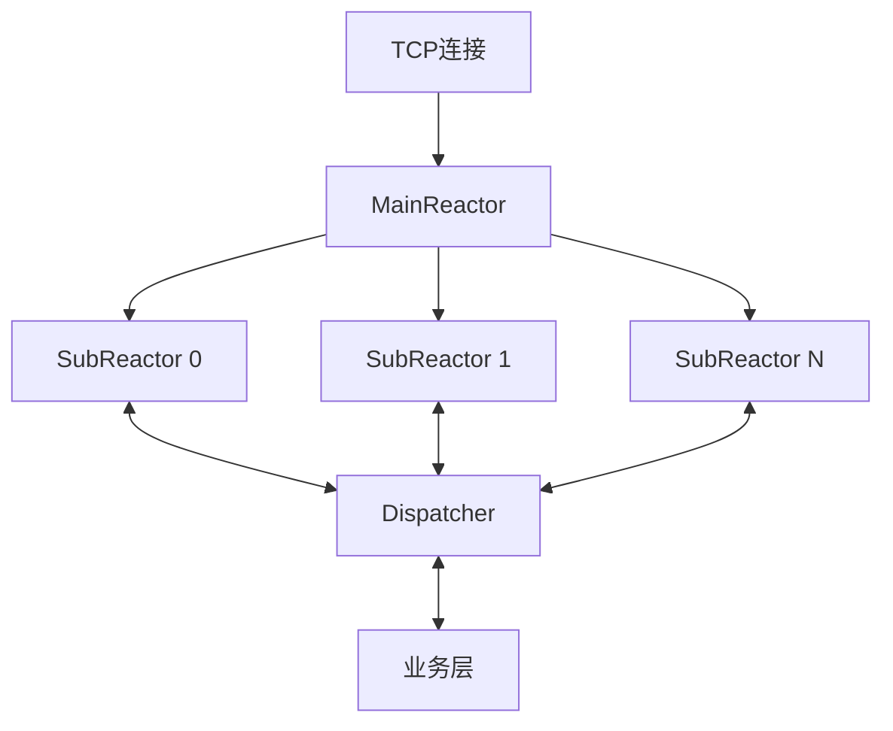
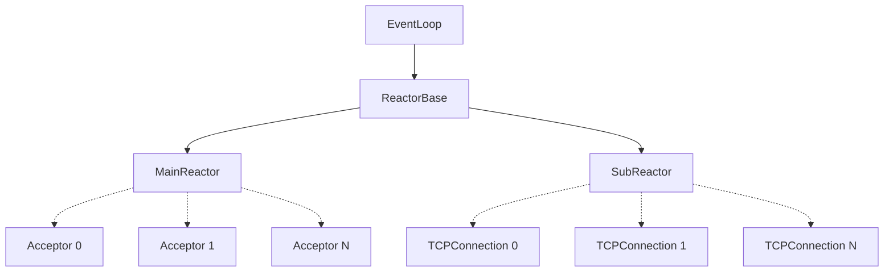
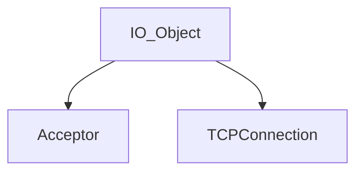
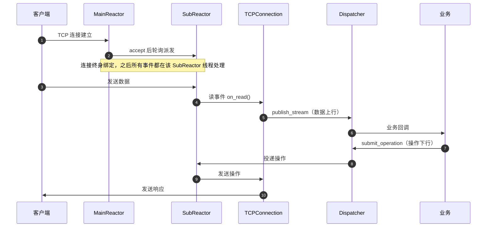

# ReactorX

> 基于 epoll 的主从 Reactor TCP 网络框架  
> 主要负责两件事：**管理连接**，**传递字节流**

`C++20` · `Linux` · `epoll`

---

## 它是什么

ReactorX 是一块网络底板。

它建立连接、维护连接、关闭连接；它收字节、发字节、缓存字节。除此之外什么都不管——不解析协议，不关心业务，不知道你发的是 HTTP 还是 protobuf。

这是刻意的克制。因为它不解析协议，所以能承载任何协议；因为它不碰业务，所以能接入任何执行模型。HTTP 框架、RPC 框架、游戏网关、自定义二进制服务，都可以直接架在它上面，而它不需要为其中任何一个改动一行。

它不是 Web 框架，也不是 RPC 框架。它是这些框架下面那一层。


## 设计取舍

一个通用框架的价值，藏在它**选择不做什么**里。

**不负责协议解析。** 粘包、半包、协议升级，全交给业务层。这是灵活性必须付的代价——一旦框架替你拆包，它就只能服务一种协议。

**不限定执行模型。** 回调怎么跑，由业务决定。可以让它直接在 SubReactor 线程里执行，享受零跨线程开销；也可以投到独立线程池，让 reactor 永不被业务阻塞。同步还是异步，是业务的选择，不是框架的规定。

**不允许连接共享。** 一条连接建立后，终身绑定到一个 SubReactor。这是全框架最硬的约束，也是收益最大的一个——它让连接的所有读写事件天然串行，不需要锁，也避免了缓存行在两个核之间反复弹跳。

**不暴露裸指针。** 连接的生命周期由框架托管，异步回调下不会出现悬垂引用。业务拿到的永远是一个可安全使用的句柄。


## 核心机制

### accept 与读写分离

MainReactor 的 Acceptor 负责 `accept`。拿到新连接，轮询分发给某个 SubReactor，立刻返回，不再关心这条连接的任何后续。

SubReactor 处理已经绑定的连接。一条连接在建立那一刻被固定到某个 SubReactor，之后它的所有读、写、错误事件，永远只在那一个线程里被处理。

结果是：**连接级串行，无需加锁。**

### 同步零开销，异步不阻塞

框架不规定回调在哪里执行，使用者可以自由选择执行模型，主要分为以下两类：

- **同步**——回调直接在 SubReactor 线程内运行。没有跨线程投递，没有队列，没有唤醒。适合轻处理，比如回一个心跳响应。
- **异步**——回调把任务投到 worker 线程池或协程，SubReactor 立刻返回继续处理 IO。适合重逻辑，比如查库、调下游。

### 分发器

业务不直接碰 reactor，也不直接碰连接对象。所有交互经过 `Dispatcher`：

- **上行**：`publish_stream` 把字节流交给业务；
- **下行**：`submit_operation` 把业务的发送、关闭指令投回对应的 SubReactor。

这个机制保证了一件事：**业务永远不会在错误的线程里操作连接。** 所有跨线程投递由框架编排。


## 架构与模型

### 主要架构



`accept` 和 `读写` 是两条独立路径。MainReactor 只负责连接的诞生，SubReactor 只负责连接的存活，Dispatcher 在 SubReactor 与 业务 之间，是上下行的唯一通道。

### 线程模型

- **1 个 MainReactor 线程**：负责 accept。所有新连接都在这一个线程里诞生，然后被派发出去。
- **N 个 SubReactor 线程**：每条连接终身绑定其中一个。该连接的读写事件、错误处理，全部在这个线程内串行完成。
- **M 个 worker 线程**：仅异步模式下存在。业务回调不阻塞 SubReactor，而是投递到由使用者自定义实现的 worker 池执行。

MainReactor 和 SubReactor 的数量在启动时确定，运行期不变。

### 组件关系

**Reactor 体系**



EventLoop → ReactorBase → MainReactor / SubReactor 为继承链；MainReactor 管理一个（也可扩展成多个） Acceptor，SubReactor 管理多个 TCPConnection。


**IO 体系**



Acceptor 和 TCPConnection 都继承自 IO_Object。


### 一条连接的完整流程



---

## 快速开始

### 环境要求

- Linux（内核支持 epoll）
- C++20 编译器：g++ 11+ 或 clang 14+
- CMake 3.15+

### 极简示例

以下是一个同步模式的示例。

无论你实现的是什么业务，只需要绑定 Dispatcher 的两个回调即可：

```cpp
#include "ReactorX.hpp"
#include <iostream>
#include <cstdlib>

int main(int argc, char* argv[])
{
    uint16_t port = argc > 1 ? std::atoi(argv[1]) : 6666;  // 监听端口
    int sub_num   = argc > 2 ? std::atoi(argv[2]) : 4;     // SubReactor 数量

    Dispatcher dispatcher;

    // 绑定业务回调：收到一段字节流（ByteStream）后处理，并回传响应
    dispatcher.set_business_callback([&dispatcher](ByteStream stream) {
        std::cout << stream.data << '\n';   // stream.data：收到的字节

        // 把数据投回框架发送
        dispatcher.submit_operation(Operation{Send_Operation{stream.token, stream.data}});    // stream.token：连接唯一标识，dispatcher通过该数据结构把Operation投递回对应的SubReactor；
    });

    // 绑定关闭回调：连接关闭时触发
    dispatcher.set_close_callback([](ConnectionToken token) {
        std::cout << "连接关闭  reactor=" << token.reactor_id
                  << " slot=" << token.slot << '\n';
    });

    /*
    dispatcher.init_mode(mode::async);      // dispatcher默认您的业务与SubReactor是同一线程的，如果业务是异步的，则需要主动调用该函数指定为异步模式
    */

    // 创建 MainReactor，监听 port，启动 sub_num 个 SubReactor
    MainReactor reactor(port, sub_num, dispatcher);

    // 启动MainReactor的eventloop
    reactor.run();
    return 0;
}
```

### 编译静态库

```bash
cmake -S . -B build
cmake --build build -j$(nproc)
# 产物：build/libReactorX.a
```

### 编译链接

```bash
g++ -std=c++20 main.cpp -I<path/to/include> build/libReactorX.a -pthread -o server
./server 6666 4
```

> **使用前请知悉**：ReactorX 不做协议解析。粘包、半包、协议边界的处理，需要业务层自行完成。这不是缺陷，是通用框架换取灵活性的必然代价。

---

## 目录结构

```text
ReactorX/
├── include/            # 框架头文件（core / net / reactor / utils）
├── src/                # 框架实现（与 include 对应）
├── README.md
└── CMakeLists.txt
```

### 分层

| 层 | 目录 | 组件 |
|---|---|---|
| 核心 | `include/core/` | `EventLoop` `Channel` `ReactorBase` `ReactorEvent` `IO_Object` |
| 网络 | `include/net/` | `Acceptor` `TCPConnection` `Dispatcher` `ConnectionToken` |
| Reactor | `include/reactor/` | `MainReactor` `SubReactor` |
| 工具 | `include/utils/` | `counter` `Err_Manager` |

---

## 性能

完整测试方案见 [`benchmark/docs/test_plan.md`](benchmark/docs/test_plan.md)。

> 数据与分析整理中。