# ReactorX 性能测试分析报告

> 项目概览与使用文档见 [`main`](https://github.com/Charon-gl/ReactorX/blob/main/README.md) 分支。

## 一、测试环境

### 1.1 硬件平台

| 项目 | 本机 (Local) | 云端 #1 (Cloud) | 云端 #2 (Cloud Sync/Async) |
|------|-------------|-----------------|---------------------------|
| CPU | i7-13650HX | Xeon 8475B | AMD EPYC |
| 微架构 | Raptor Lake | Sapphire Rapids | Zen 4/5 |
| 物理核 | 6P + 8E (14) | 96 (双 NUMA) | 64 (单物理 NUMA, 4 vNUMA) |
| 超线程 | P 核开启 / E 核无 | 关闭 | 关闭 |
| OS | Ubuntu 24.04 (物理机) | Ubuntu 24.04 (裸金属) | Ubuntu 24.04 |
| 编译器 | g++ (C++20, -O2 Release) | g++ (C++20, -O2 Release) | g++ (C++20, -O2 Release) |
| 测试工具 | wrk2 + perf | wrk2 + perf | wrk2 |

### 1.2 核绑策略

每个服务端线程通过 `taskset` / `numactl` 绑定到一个物理核，不使用超线程兄弟核。

- **本机**：MainReactor + SubReactor 使用 P 核，Async Worker 使用 E 核
- **云端 #1**：双 NUMA 节点，服务端与客户端分属不同 NUMA，服务端进程内部无跨 NUMA 访问
- **云端 #2**：单物理 NUMA，操作系统虚拟为 4 vNUMA

### 1.3 架构模型

```
┌─────────────────────────────────────────────────┐
│              MainReactor                         │
│           (1 thread, pinned)                     │
│   accept() ──round-robin──> SubReactor[0..N]    │
└─────────────────────────────────────────────────┘
                    │
          ┌─────────┴──────────┐
          ▼                    ▼
┌─────────────────────┐ ┌──────────────────────────────┐
│    Sync 模型         │ │    Async 模型                │
│                     │ │                              │
│  SubReactor 线程    │ │  SubReactor 线程             │
│    │                │ │    │                         │
│    │ on_read()      │ │    │ enqueue -> worker       │
│    │ on_request()   │ │    │         queue           │
│    │ push_request() │ │    │ push_request_async()    │
│    ▼                │ │    ▼                         │
│    业务处理          │ │  业务线程池                  │
│    (阻塞)           │ │    │ 业务处理 (阻塞)          │
│    response()       │ │    │ response()               │
│                     │ │    ▼                         │
│ * 阻塞 SubReactor   │ │  Dispatcher ──> SubReactor    │
│                     │ │  (跨线程投回响应)             │
│                     │ │ + 仅阻塞 Worker              │
└─────────────────────┘ └──────────────────────────────┘
```

- **Sync 模型**：业务回调（`push_request`）在 SubReactor 线程内同步执行，阻塞型业务会阻塞整个 SubReactor 线程。
- **Async 模型**：使用独立的 Worker 线程池处理业务，通过 `Dispatcher` 找到对应的路由端口将响应投回 SubReactor。阻塞型业务仅阻塞 Worker 线程，IO 线程不受影响。**业务层不使用协程。**
- **共享业务层**：sync 和 async 调用完全相同的 `business::process_request()`，唯一差异是执行线程——sync 在 SubReactor 线程执行，async 在 Worker 线程执行。两者对业务逻辑无感知差异。

---

## 二、压测方法论

### 2.1 工具与协议

| 项目 | 说明 |
|------|------|
| 压测工具 | **wrk2**（定速模式 `-R`，HDR Histogram 精确延迟到高 9 位） |
| 协调遗漏修正 | wrk2 内置，避免传统 wrk 在过载时低估延迟 |
| 连接模式 | HTTP/1.1 Keepalive（长连接复用，无连接建立/关闭开销）；Pipeline 模式额外测试 |
| 连接数 | baseline/scalability: 2000；sync/async 对照: 11B=2000, compute/delay=100 |
| 发压速率 | 基于拐点扫描自动确定 `knee_rate`（P99 突变 2× 处），正式测试取拐点速率 |

### 2.2 测试流程

1. **拐点扫描**：从低速率开始倍增，每档 15s，检测 P99 突变（≥ 2× 基线）确定拐点
2. **正式测量**：在拐点速率处重复 3 次、每次 30s，取中位数（平滑偶发噪声）
3. **perf 采样**：同步采集 IPC、Cache Miss Rate、Branch Miss Rate（`perf stat` 事件计数）
4. **火焰图**：`perf record` + FlameGraph 脚本生成 SVG

### 2.3 数据质量

| 指标 | 说明 |
|------|------|
| 错误率 | 所有 baseline/scalability/pipeline 测试 **err_connect = err_read = err_write = err_timeout = 0** |
| P99 约束 | 硬约束 P99 ≤ 10ms（`p99_limit_us = 10000`），超限标记 `within_latency_limit = False` |
| 客户端饱和 | baseline 全部 `wrk_saturated = False`；scalability sync-32 11B 下 wrk CPU ≈ 3300%（48 核），接近饱和 |
| 重复测试 | baseline/scalability/pipeline 每配置单次运行取拐点值；sync/async 对照及隔离性实验每配置重复 3 次取 median |
| 延迟指标 | 各图表展示 P50 / P99 / P99.9 / P99.99 四档百分位延迟 |
| CPU 频率 | 将 governor 切换为 `performance`（锁最高频），消除 Turbo 动态调频影响 |

### 2.4 测试配置详情

**本机 (Local)**：

| 测试 | 场景 | SubReactor | 服务端核 | wrk 线程数 | 连接数 | 负载 |
|------|------|-----------|---------|-----------|--------|------|
| baseline | sync-4 | 4 | 5 (P核) | 9 | 2000 | 11B / 16KB / 64KB |
| pipeline | sync-4 | 4 | 5 (P核) | 9 | 2000 | 64KB (keepalive + pipeline) |
| async | sync-4 vs async-4 | 4 | 5 (P核) + 4 (E核) | 9 | 2000 | 11B |
| scalability | sync-1 / sync-4 | 1→4 | 2→5 (P核) | 12 / 9 | 2000 | 16KB |

**云端 #1 (Cloud)**：

| 测试 | 场景 | SubReactor | 服务端核 | wrk 线程数 | 连接数 | 负载 |
|------|------|-----------|---------|-----------|--------|------|
| baseline | sync-16 | 16 | 17 | 48 | 2000 | 11B / 16KB / 64KB |
| pipeline | sync-16 | 16 | 17 | 48 | 2000 | 64KB (keepalive + pipeline) |
| scalability | sync-4/8/16/32 | 4→32 | 5→33 | 48 | 2000 | 11B / 64KB |

**云端 #2 (Cloud Sync/Async)**：

| 测试 | 场景 | SubReactor | 服务端核 | wrk 线程数 | 连接数 | 负载 |
|------|------|-----------|---------|-----------|--------|------|
| 11B echo | sync-16 vs async-16 | 16 | 25 | 32 | 2000 | 11B |
| compute | sync-16 vs async-16 | 16 | 25 | 32 | 100 | compute-light/medium/heavy |
| delay | sync-16 vs async-16 | 16 | 25 | 32 | 100 | delay-10ms / delay-100ms |

> **delay 测试说明**:
>- delay 场景放开超时限制（`--timeout = 60s`），因为 sync 模型下延迟会膨胀到秒级，wrk2 默认 2s / 脚本默认 5s 超时会导致大量 timeout 错误。  
>- sync vs async 对比具有可比性：两者在同一硬件、同一 offered_rate、同一 timeout 下测量。  
>- 注意 sync overload 下的 P99 受 timeout 上限约束，实际可能更高，但不影响"sync 远差于 async"的结论。  
    
**隔离性对比实验 (Isolation)**：

| 实验 | 负载组成 | SubReactor | 服务端核 | wrk 线程 | 连接数 | 目标速率 |
|------|---------|-----------|---------|---------|--------|---------|
| compute_mix | 90% /fast(1ms) + 10% /compute(3M iter) | 8 | 9 (N0绑核) | 32 | 2000 | R=2000 / R=5000 |
| delay_mix | 90% /fast(1ms) + 10% /slow(300ms) | 8 | 9 (N0绑核) | 32 | 2000 | R=1000 / R=3000 |

- sync 模式：8 SubReactor（无 Worker），业务在 SubReactor 线程执行
- async 模式：8 SubReactor + 8 Worker，业务在 Worker 线程执行
- 每配置 30s 预热 + 3 × 90s 正式测试取中位数

---

## 三、本机性能 (i7-13650HX)

### 3.1 Baseline — 不同负载下的吞吐与延迟

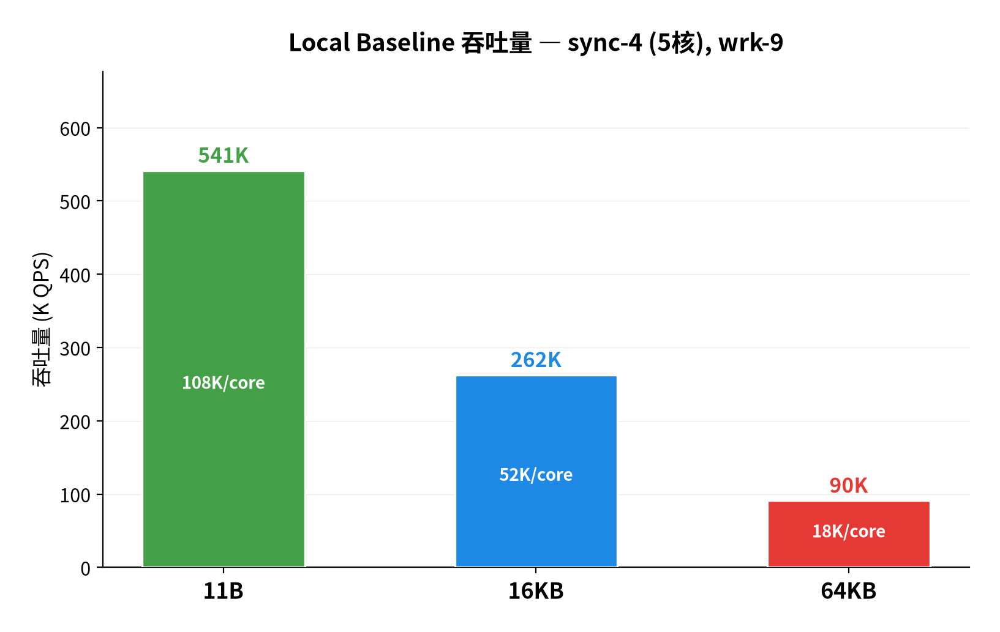

sync-4 模型（1 MainReactor + 4 SubReactor，共 5 个 P 核，wrk-9）：

| 负载 | QPS | 每核 QPS | P50 | P99 | P99.9 | wrk CPU |
|------|-----|----------|-----|-----|-------|---------|
| 11B echo | 541K | 108K/core | 1.65ms | 3.55ms | 3.97ms | 575% |
| 16KB | 262K | 52K/core | 1.83ms | 3.87ms | 4.76ms | 599% |
| 64KB | 91K | 18K/core | 2.09ms | 4.87ms | 5.54ms | 311% |

- 所有测试零错误（connect/read/write/timeout = 0），客户端未饱和
- 从 11B 到 64KB，吞吐下降 83%，但 P99 延迟仅增加 37%（3.55ms → 4.87ms）。延迟增长远小于吞吐下降，说明瓶颈在**内存带宽与数据拷贝**而非协议处理开销
- 64KB 下 wrk CPU 仅 311%（9 线程），客户端远未饱和

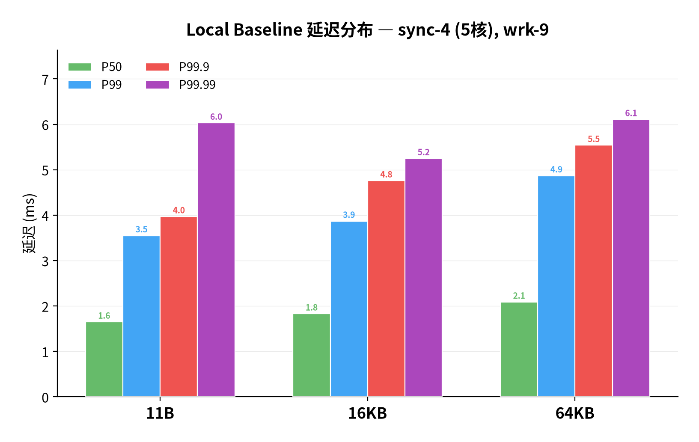

### 3.2 Pipeline 对比

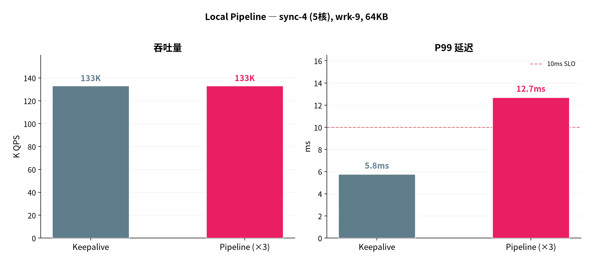

64KB 负载，Pipeline（单连接连续发 3 个请求）vs 普通 Keepalive。**注意**：Pipeline 实验使用独立的 knee_rate 扫描（138K vs baseline 的 95K），因此此处的 Keepalive 吞吐（133K）高于 §3.1 baseline 值（91K）——这是不同 knee_rate 的差异，并非性能实测矛盾。

| 模式 | QPS | P50 | P99 | P99.9 | wrk CPU |
|------|-----|-----|-----|-------|---------|
| Keepalive | 133K | 3.10ms | 5.76ms | 6.51ms | 444% |
| Pipeline (×3) | 133K | 5.03ms | 12.70ms | 14.15ms | 267% |

Pipeline 吞吐几乎无提升——瓶颈在服务端 CPU/内存而非连接数；P99 延迟翻倍，原因是单连接上请求串行化导致队头阻塞（Head-of-Line Blocking）。

### 3.3 扩展性 — sync-1 → sync-4

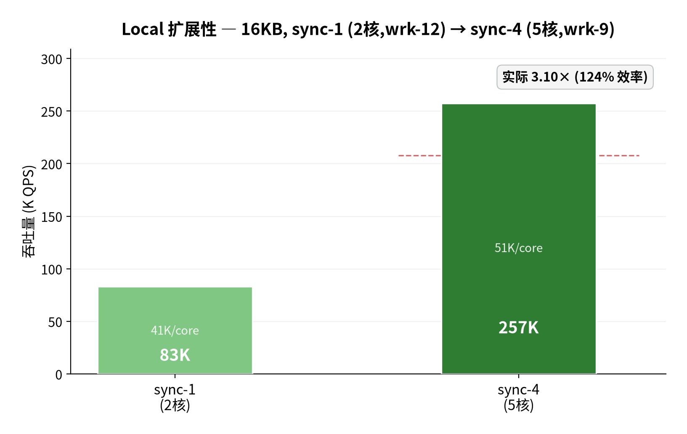

16KB 负载下，从 sync-1 (2 核, wrk-12) 扩展到 sync-4 (5 核, wrk-9)：

| 配置 | QPS | 每核 QPS | P99 | P99.9 |
|------|-----|----------|-----|-------|
| sync-1 (2 核) | 83K | 42K/core | 7.15ms | 7.78ms |
| sync-4 (5 核) | 257K | 51K/core | 3.76ms | 4.41ms |

按总核数算，扩展比 3.10× / 核数比 2.5× = 124% 效率，看似超线性。但按 SubReactor 核数算：

| 配置 | QPS | 每 SubReactor 核 QPS | SubReactor 扩展效率 |
|------|-----|---------------------|-------------------|
| sync-1 (1 Sub) | 83K | 83K/core | 100% |
| sync-4 (4 Sub) | 257K | 64K/core | 77% |

**实际是亚线性扩展（77%）**。按总核数算出的"超线性"是测量假象：`qps_per_core = qps / server_cores` 的分母包含 MainReactor 核，sync-1 时 2 核中 1 核做 accept（50% 开销核），sync-4 时 5 核中仅 1 核做 accept（20% 开销核），有效核占比提升造成了虚假的超线性。此外 sync-1 和 sync-4 的 wrk 线程数不同（12 vs 9），也引入了客户端施压能力的差异。

### 3.4 微架构分析

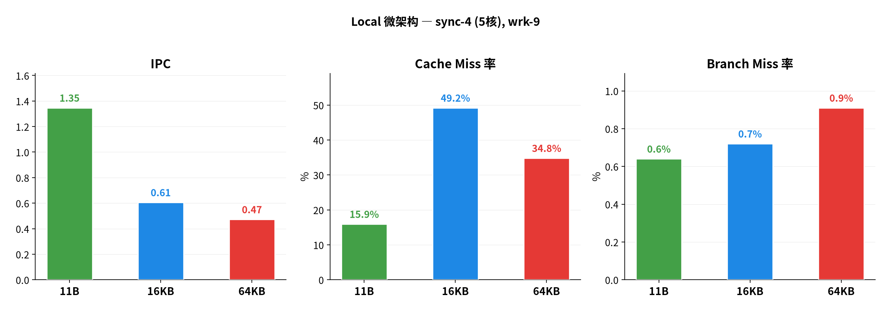

| 指标 | 11B | 16KB | 64KB |
|------|-----|------|------|
| IPC | 1.35 | 0.61 | 0.47 |
| Cache Miss | 15.9% | 49.2% | 34.8% |
| Branch Miss | 0.64% | 0.72% | 0.91% |

- **IPC 断崖**：1.35 → 0.47，约 90% 时间在等待内存子系统
- **16KB Cache Miss 最高**：16KB payload 约为 L1D (48KB) 的 1/3，频繁 `memcpy` 冲刷 L1 缓存
- **64KB 反而降低**：数据量增大后硬件 Prefetcher 更有效
- **Branch Miss 始终很低**：epoll 事件分发逻辑中分支预测效果良好

### 3.5 火焰图

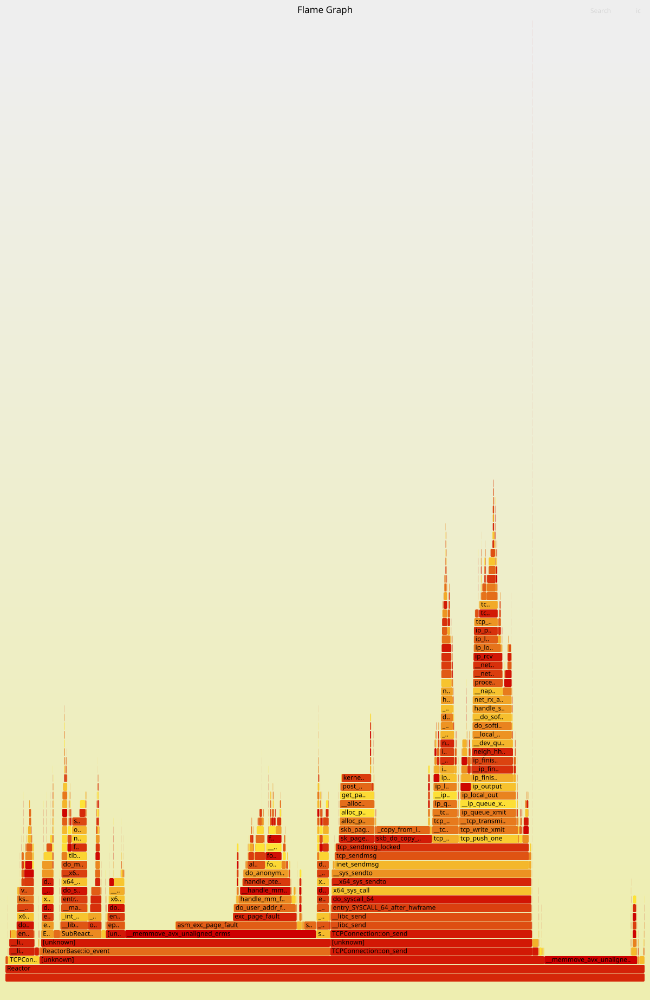

本机 sync-4 (keepalive, 64KB) Top 5 热点：

| 函数 | 占比 | 类别 |
|------|------|------|
| `exc_page_fault` | 9.95% | 缺页异常 |
| `skb_do_copy_data_nocache` | 9.00% | skb 数据拷贝 |
| `__ip_queue_xmit` | 8.73% | IP 层发送 |
| `__tcp_push_pending_frames` | 4.16% | TCP 协议栈 |
| `handle_softirqs` | 1.86% | 软中断处理 |

---

### 3.6 Echo 纯框架性能

> wrk2 测试的延迟包含 HTTP 解析、wrk2 自身调度等开销，无法直接测量框架的纯 TCP 往返延迟。本节使用自研的 epoll echo 客户端（`echo_client.cpp`），直接收发 TCP 字节流、服务端原样回显（`echo_server.cpp`，基于 ReactorX 的纯 TCP 模式），精确测量框架层的延迟与吞吐。

测试矩阵：sub1（1 SubReactor）和 sub4（4 SubReactor）各测试 3 种负载（11B / 16KB / 64KB）× 8 档连接数（10–1000），每档重复 2 次取较优。客户端使用 epoll + 非阻塞 socket，默认 4 worker 线程。

**与 wrk2 的关键区别**：

| 维度 | wrk2 | echo_client |
|------|------|-------------|
| 协议层 | HTTP/1.1（含解析开销） | 纯 TCP 字节流 |
| 协调遗漏修正 | 内置 HDR Histogram 修正 | 客户端直接计时，无遗漏 |
| 客户端模型 | 多线程阻塞 IO | 单 epoll 实例 + 多 worker |
| 延迟含义 | 包含 HTTP 解析 + wrk2 队列 | 纯 TCP 往返 |

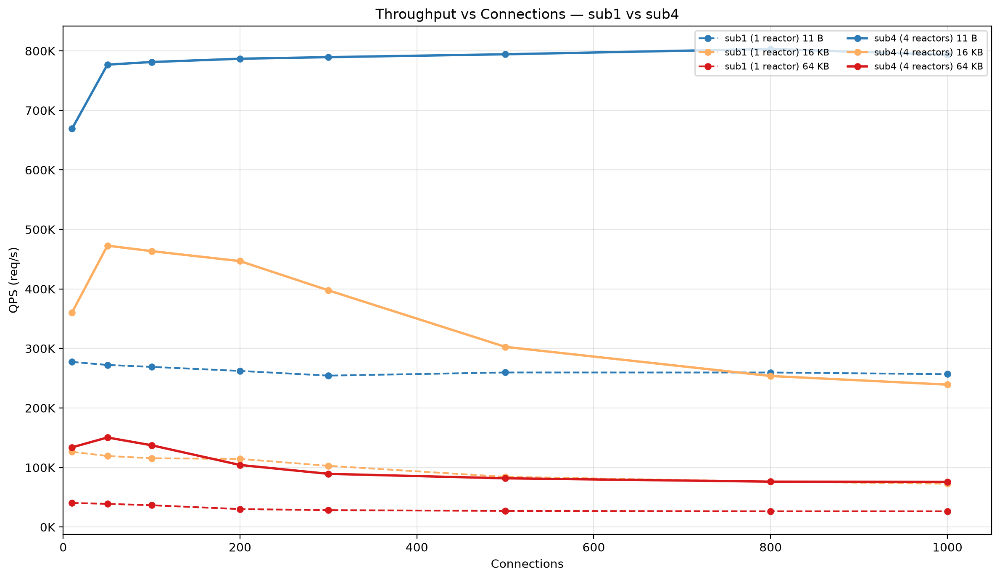

**sub1 和 sub4 的 peak 吞吐与延迟**（取各自 QPS 最高的连接数点）：

| 配置 | 负载 | peak QPS | @conn | P50 | P99 | P99.9 | P99.99 |
|------|------|----------|-------|-----|-----|-------|--------|
| sub1 | 11B | 277K | 10 | 36µs | 42µs | 44µs | 47µs |
| sub1 | 16KB | 126K | 10 | 79µs | 88µs | 94µs | 104µs |
| sub1 | 64KB | 40K | 10 | 252µs | 282µs | 296µs | 341µs |
| sub4 | 11B | 803K | 800 | 1213µs | 1240µs | 1443µs | 2355µs |
| sub4 | 16KB | 467K | 50 | 118µs | 177µs | 194µs | 274µs |
| sub4 | 64KB | 89K | 300 | 4694µs | 7173µs | 7324µs | 7460µs |

> sub4 64KB 在 300 连接处出现 QPS 跳变（45K→89K），此时客户端 cpu_cores 从 1.79 跳至 4.00，是客户端自动扩 worker 导致的，非服务端性能突变。

**与 wrk2 baseline 的延迟对比**（本机 sync-4，11B）：

| 来源 | P50 | P99 | P99.9 |
|------|-----|-----|-------|
| wrk2 (§3.1) | 1.65ms | 3.55ms | 3.97ms |
| echo sub4 @peak | 1.21ms | 1.24ms | 1.44ms |
| echo sub4 @10conn | **14µs** | **27µs** | **29µs** |

wrk2 的延迟约是 echo 同连接数下的 1.4–2.9 倍，差额来自 HTTP 解析开销和 wrk2 内部的请求排队。echo sub4 在 10 连接时 P50 仅 14µs——这是框架在当前硬件上纯 TCP 往返的近似下界。

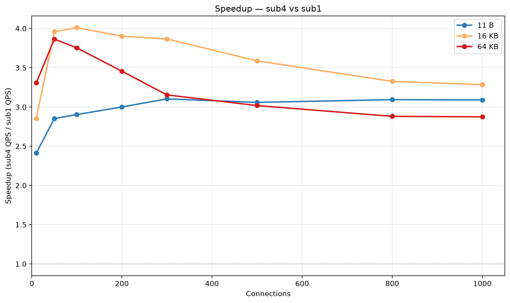

**sub4 / sub1 加速比**（同连接数下 QPS 之比）：

| 连接数 | 10 | 50 | 100 | 200 | 300 | 500 | 800 | 1000 |
|--------|----|----|-----|-----|-----|-----|-----|------|
| 11B | 2.4× | 2.9× | 2.9× | 3.0× | 3.1× | 3.1× | 3.1× | 3.1× |
| 16KB | 2.8× | 3.9× | 4.0× | 3.9× | 3.8× | 3.5× | 3.4× | 3.3× |
| 64KB | 1.2× | 1.3× | 1.3× | 1.5× | 3.2× | 3.0× | 2.9× | 2.9× |

11B 加速比从 2.4× 起步、收敛到约 3.1×——对 4× SubReactor 来说接近线性但未完全达到。16KB 在低连接数下出现过 4.0× 的超线性，因为 sub1 单 reactor 在 16KB 下更早达到瓶颈。64KB 低连接数下加速比仅 1.2–1.5×，瓶颈在内存带宽而非 reactor 数量，300 连接后客户端扩 worker 导致数据不可比。

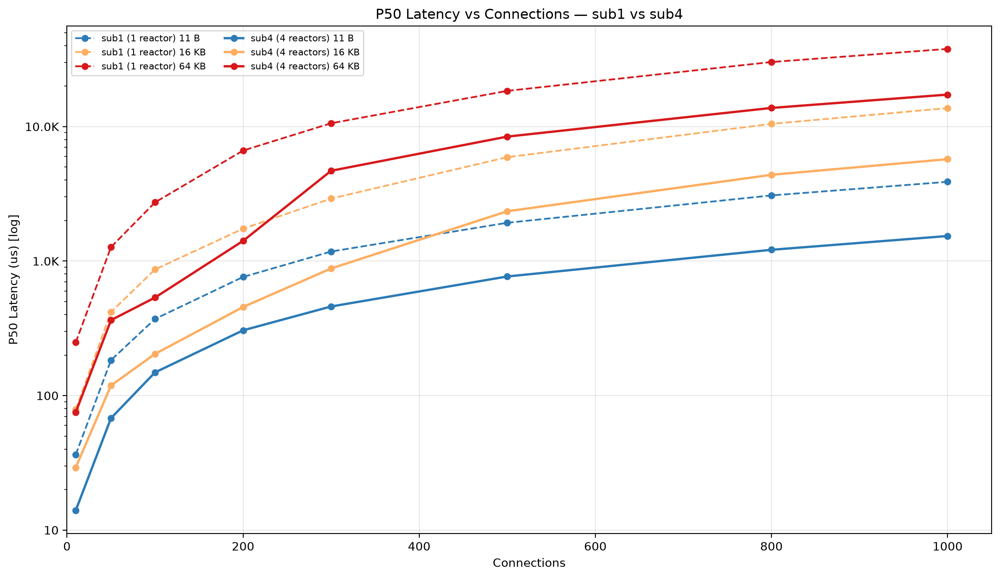
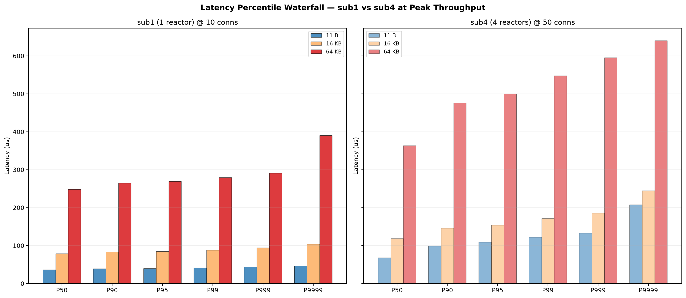

P50 延迟随连接数线性增长——每个 SubReactor 独占一个 epoll 实例，连接被均匀分配到各 reactor 上。连接数翻倍意味着每个 epoll 内的连接数翻倍，每连接的平均轮询间隔同比增加。sub4 的延迟显著低于 sub1（同等总连接数下约 1/3），因为 4 个 SubReactor 分摊了连接，每个 epoll 仅承担 1/4 的连接数。

---

## 四、云端性能 (Xeon 8475B, 裸金属)

### 4.1 Baseline — sync-16

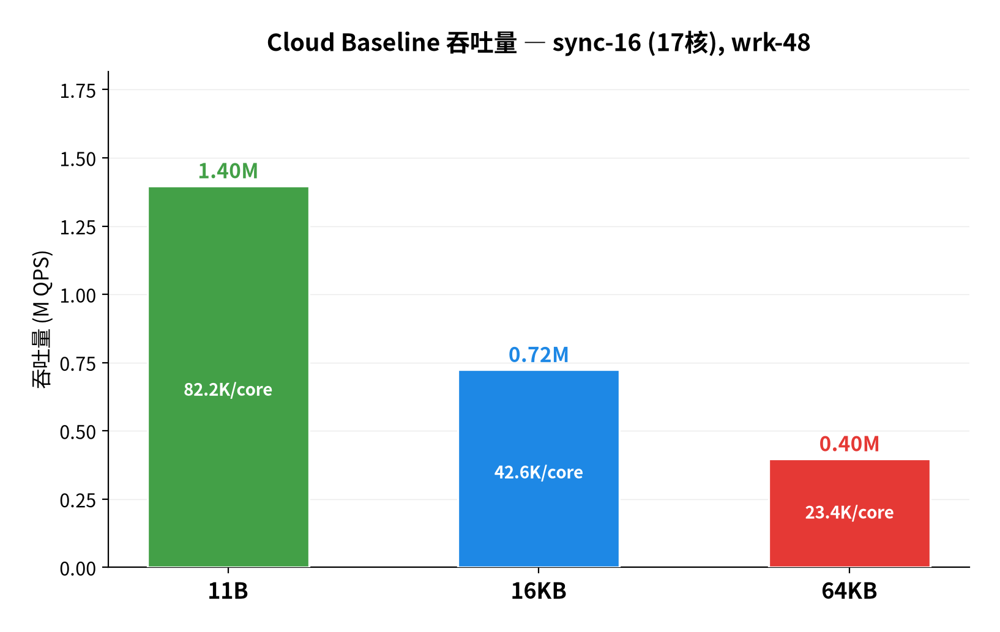

sync-16 模型（1 MainReactor + 16 SubReactor，共 17 核，wrk-48）：

| 负载 | QPS | 每核 QPS | P50 | P99 | P99.9 | wrk CPU |
|------|-----|----------|-----|-----|-------|---------|
| 11B echo | 1.40M | 82K/core | 1.25ms | 2.63ms | 3.05ms | 1574% |
| 16KB | 0.72M | 43K/core | 1.05ms | 2.28ms | 2.68ms | 1091% |
| 64KB | 0.40M | 23K/core | 1.43ms | 2.81ms | 3.12ms | 1035% |

- 所有测试零错误，客户端未饱和
- 相比本机：11B 每核 82K vs 108K（Raptor Lake 单核 IPC 更高），但延迟整体更低

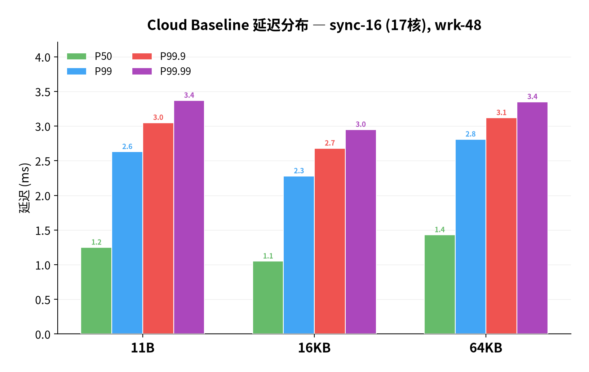

### 4.2 Pipeline 对比

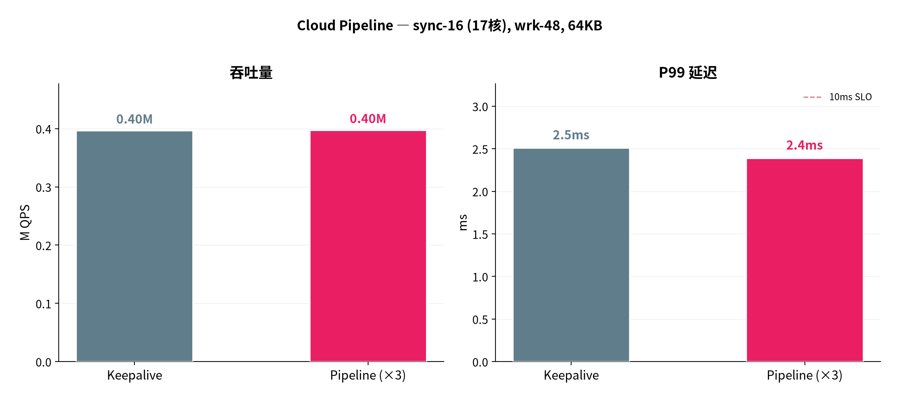

64KB 下 Pipeline 吞吐几乎持平，P99 略优（2.39ms vs 2.51ms）。云端 PCIe 带宽更充裕，队头阻塞影响被部分稀释。

### 4.3 扩展性 — sync-4 → sync-32

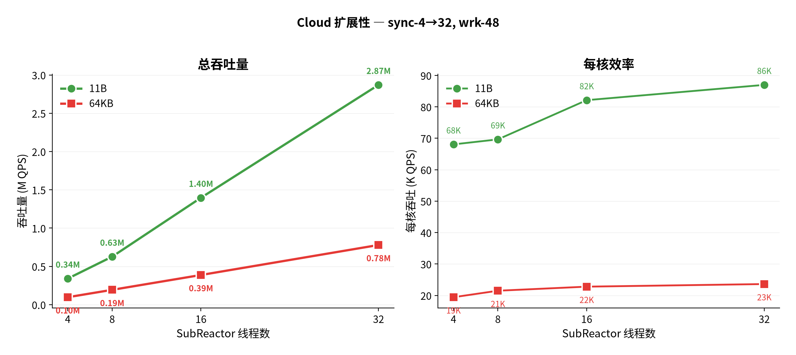

| SubReactor | 服务端核 | 11B QPS | 64KB QPS | 11B/核 | 64KB/核 | 11B wrk CPU |
|------------|---------|---------|----------|--------|---------|-------------|
| sync-4 | 5 | 0.34M | 0.097M | 68K/core | 19K/core | 458% |
| sync-8 | 9 | 0.63M | 0.193M | 70K/core | 21K/core | 770% |
| sync-16 | 17 | 1.40M | 0.387M | 82K/core | 23K/core | 1577% |
| sync-32 | 33 | 2.87M | 0.779M | 87K/core | 24K/core | 3298% |

- 4 → 32 线程（核数 6.6×），11B 总吞吐增长 **8.4×**，64KB 增长 **8.0×**——按总核数算超线性
- **sync-32 下 wrk CPU ≈ 3300%**（48 线程），客户端接近饱和，实际吞吐可能被客户端限制

**按 SubReactor 核数重新评估**：

| SubReactor | 11B 每 Sub 核 | 11B Sub 扩展效率 | 64KB 每 Sub 核 | 64KB Sub 扩展效率 |
|------------|--------------|-----------------|--------------|-----------------|
| sync-4 | 85K/core | 100% | 24K/core | 100% |
| sync-8 | 78K/core | 92% | 24K/core | 100% |
| sync-16 | 87K/core | 103% | 24K/core | 100% |
| sync-32 | 90K/core | 105% | 24K/core | 100% |

- **64KB 完美线性扩展**（100%），按总核数的"超线性"是 MainReactor 核占比稀释的测量假象
- **11B 基本线性**（92%–105%）
- 每核吞吐随线程数微升（87K→90K）是因为 epoll 事件分摊到更多线程后上下文切换开销降低

### 4.4 扩展效率

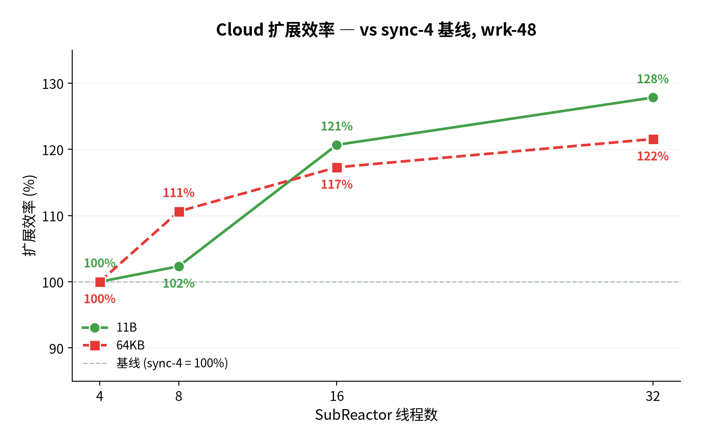

以 sync-4 为基线（100%），衡量增加线程后实际吞吐 vs 按总核数线性扩展的预期吞吐。

- 11B：sync-8 = 102%，sync-16 = 121%，sync-32 = 128%——按总核数看似超线性
- 64KB：sync-8 = 111%，sync-16 = 117%，sync-32 = 122%——同上

但如上节分析，按 SubReactor 核数评估，64KB 为完美线性（100%），11B 基本线性（92%–105%）。图中超线性源于 MainReactor 核在总核数中的占比随线程增加而稀释。

### 4.5 微架构趋势

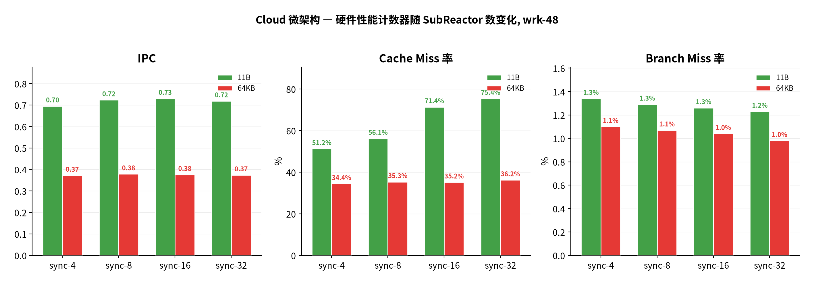

**按 SubReactor 数分组，11B 与 64KB 对比**：

- **IPC**：11B 下稳定在 0.70–0.73，64KB 下稳定在 0.37–0.38。与线程数几乎无关——瓶颈在内存而非并行度
- **Cache Miss**：11B 下从 sync-4 的 51% 逐步攀升至 sync-32 的 75%（线程数增加导致 L3 cache 竞争加剧），64KB 下稳定在 34%–36%
- **Branch Miss**：范围 0.98%–1.34%，分支预测良好

### 4.6 火焰图

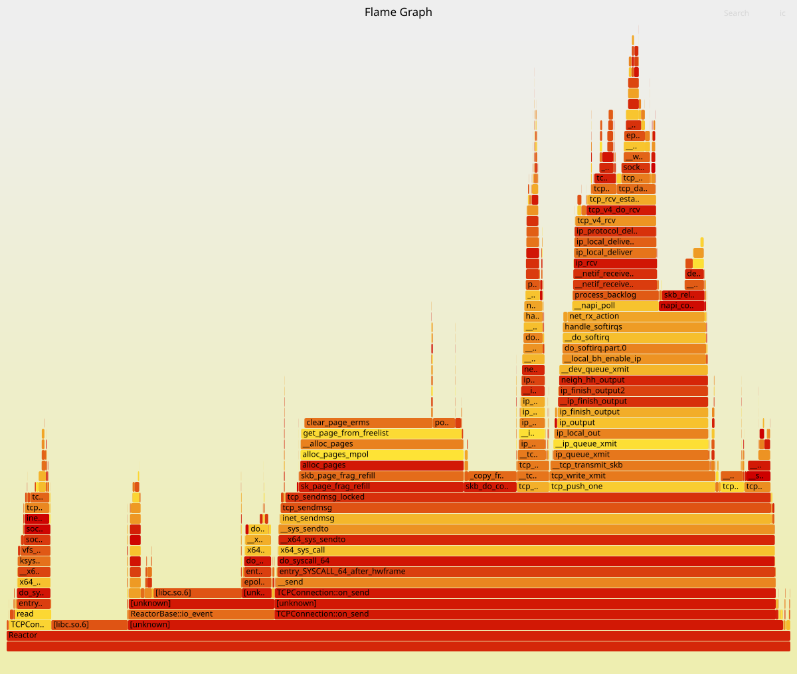

云端 sync-16 (keepalive, 64KB) Top 5 热点：

| 函数 | 占比 | 类别 |
|------|------|------|
| `__ip_finish_output` | 19.15% | IP 层输出 |
| `__dev_queue_xmit` | 18.95% | 设备队列发送 |
| `_copy_from_iter` | 6.18% | 用户态拷贝 |
| `vfs_read` | 3.84% | VFS 读取 |
| `__tcp_transmit_skb` | 3.60% | TCP 传输 |

网络 TX 路径（`__ip_finish_output` + `__dev_queue_xmit`）合计占 **38%** CPU，瓶颈在向外发送数据。

---

## 五、Sync vs Async 对比 (AMD EPYC)

### 5.1 11B Echo

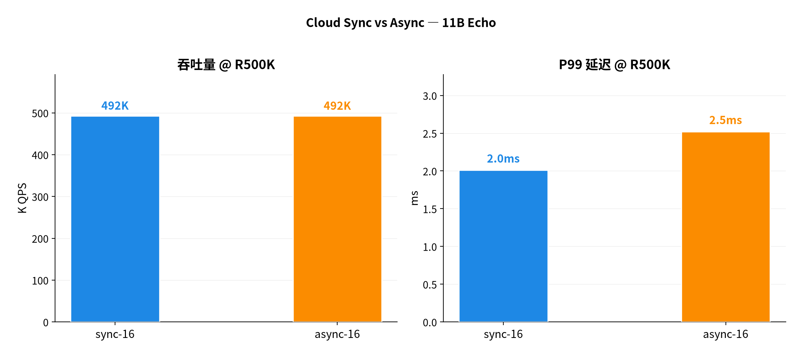

sync 和 async 吞吐相当（~494K QPS），sync 的 P99 略低（2.0ms vs 2.5ms）——async 的跨线程投递引入少量额外延迟。

### 5.2 CPU 计算负载

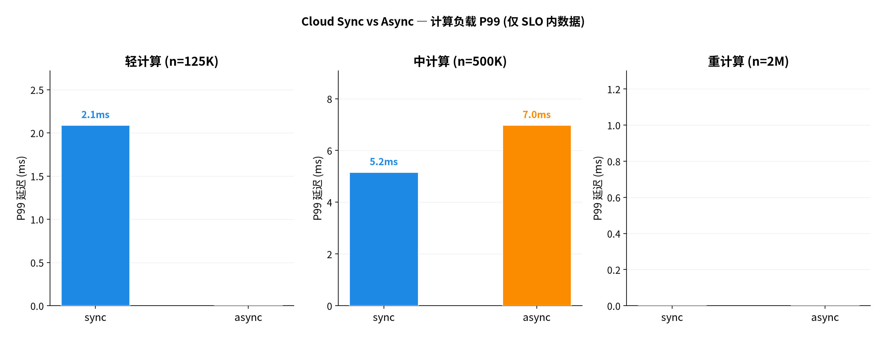

> 仅取 `within_latency_limit = True` 的数据做 median，排除过载数据点。图表中缺失的柱子表示该配置的所有重复实验均超过 10ms P99 硬上限。

| 计算强度 | 发压速率 (sync / async) | Sync P99 | Async P99 |
|----------|------------------------|----------|-----------|
| 轻计算 (n=125K) | 16K / 32K | ~2.1ms | **—** (无 SLO 内数据) |
| 中计算 (n=500K) | 8K / 8K | ~5.2ms | ~7.0ms (仅 1/3 次满足 SLO) |
| 重计算 (n=2M) | 1K / 2K | **—** (无 SLO 内数据) | **—** (无 SLO 内数据) |

**仅 sync 中计算在 P99 ≤ 10ms 约束下仍有可比数据**。轻计算下 async 在 32K 发压速率时全部 3 次重复均超过 SLO（P99 = 1.71s–1.89s），说明 Worker 线程池在更高 QPS 下的排队效应比 SubReactor 更早触发延迟雪崩。中计算下 async 仅 1/3 次保持 P99 在 10ms 内（7.0ms，其余两次约 0.98s 和 1.04s），同步模型 3 次均通过（5.2ms）。

**结论**：在 P99 ≤ 10ms 的 SLO 硬约束下，sync 模型在 CPU 计算场景的延迟更可控。需要注意 async 配置使用了 8 个 Worker 线程（加上 16 个 SubReactor 共 24 线程），而 sync 仅 16 个 SubReactor 线程——更多线程带来的上下文切换和入队开销可能是 async 表现不如 sync 的部分原因。当前数据不足以得出"sync 绝对优于 async"的结论，等线程数对照实验留待后续补充。

### 5.3 IO 延迟模拟

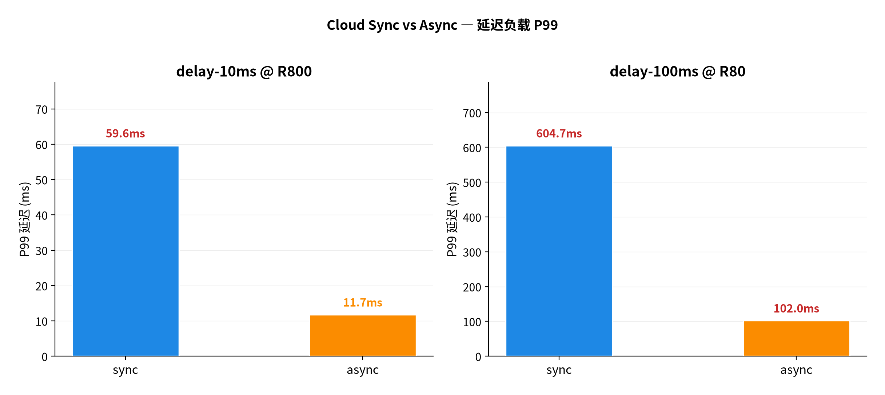

> delay 测试放开超时限制（`--timeout = 60s`），因为 sync 模型下 P99 会膨胀到秒级。图表取所有重复实验（不区分 SLO）的 median P99，sync vs async 在同一硬件、同一 offered_rate 下对比。

| 延迟 | 发压速率 | Sync P99 | Async P99 | Async 优势 |
|------|---------|----------|-----------|------------|
| 10ms | 800 | ~59.6ms | ~11.7ms | **5.1×** |
| 100ms | 80 | ~604.7ms | ~102.0ms | **5.9×** |

sync 的 P99 放大倍数是固定的：100 连接 / 16 SubReactor ≈ 6.25 连接/线程。当同一 SubReactor 上 6 条连接几乎同时发出延迟请求时，最末请求需排队 5 次 × sleep = 5×10ms=50ms（加上自身处理 10ms → 60ms），与实测 P99≈59.6ms 吻合。100ms 场景同理：6×100ms=600ms vs 实测 604.7ms。

async 的 P99 接近 sleep 本身——10ms 场景放大 1.17×（11.7ms），100ms 场景放大仅 1.02×（102.0ms），额外开销主要来自跨线程投递和调度唤醒延迟。

### 5.4 模型选择策略

| 场景 | 推荐模型 | 原因 |
|------|---------|------|
| 纯 echo | Sync | 无跨线程调度开销，P99 更低（2.0ms vs 2.5ms） |
| CPU 密集计算 | Sync | SLO 硬约束下承载力更强，Worker 调度开销抵消并行收益 |
| IO 等待 / 下游调用 | **Async** | SubReactor 不被阻塞，延迟放大仅 1.17× vs sync 的 6× |
| 混合负载 | **Async** | 低延迟流量不受高延迟流量影响（见 §6 隔离性实验） |

---

## 六、隔离性对比实验 (Isolation Test)

> **设计思路**：旧版 sync/async delay 对比存在方法学问题——async 对 `/delay` 路径使用了独立定时器线程绕过阻塞，而 sync 只能 `sleep()`。新版实验让 sync 和 async 调用**完全相同的** `business::process_request()` 函数，唯一的差异是**执行线程**（SubReactor vs Worker），确保对比的是框架层隔离性而非业务层优化。

两个混合负载实验，每个包含 sync（8 SubReactor）和 async（8 Sub + 8 Worker）两种模式，在云端的 AMD EPYC 上完成：

| 参数 | compute_mix | delay_mix |
|------|------------|-----------|
| 负载组成 | 90% /fast(1ms) + 10% /compute(3M iter ≈10ms) | 90% /fast(1ms) + 10% /slow(300ms) |
| 目标速率 | R=2000 / R=5000 | R=1000 / R=3000 |
| 连接数 | 2000 | 2000 |

### 6.1 Compute Mix — 隔离性决定尾部延迟

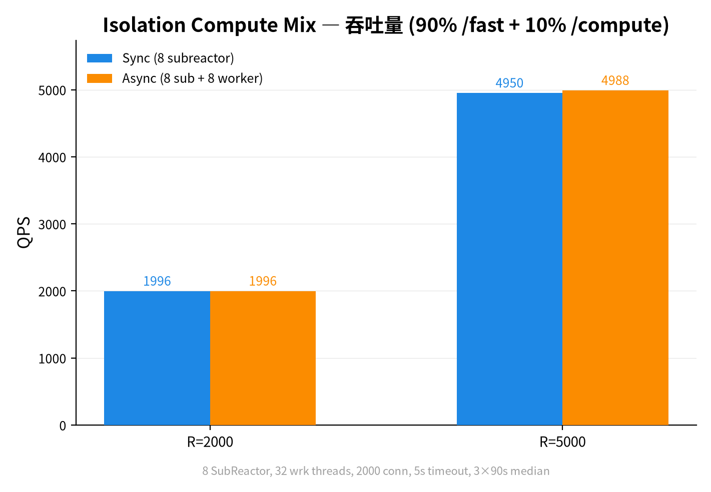
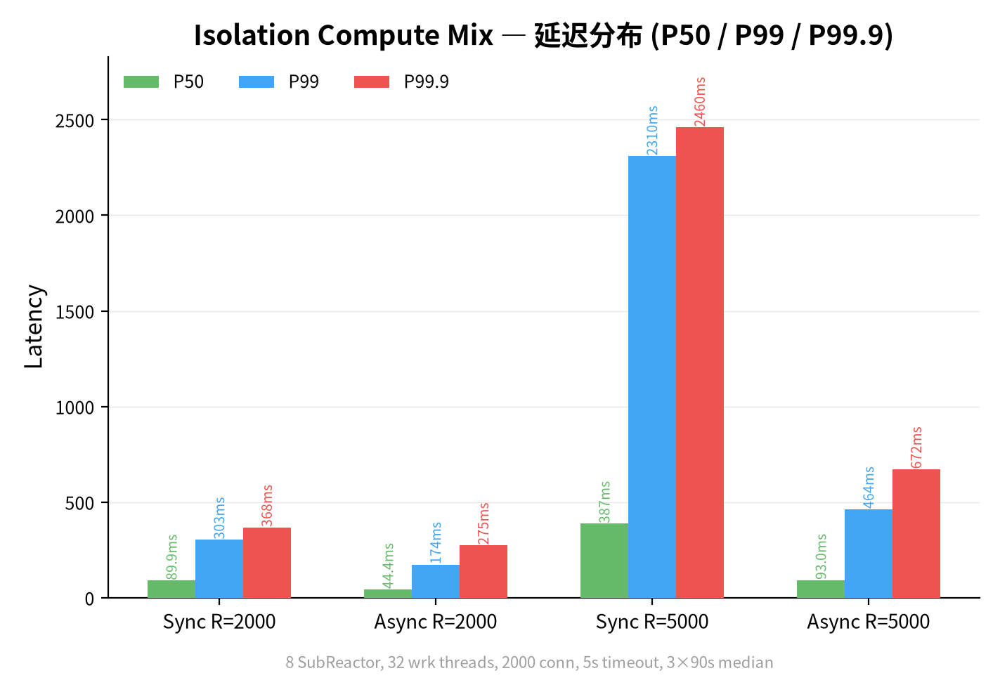

| 速率 | 模式 | QPS | P50 | P99 | P99.9 | err_timeout |
|------|------|-----|-----|-----|-------|-------------|
| R=2000 | sync | 1996 | 89.9ms | 303ms | 368ms | 0 |
| R=2000 | async | 1996 | **44.4ms** | **174ms** | **275ms** | 0 |
| R=5000 | sync | 4950 | 387ms | 2310ms | 2460ms | 0 |
| R=5000 | async | 4988 | **93.0ms** | **464ms** | **672ms** | 0 |

async 在两种速率下都显著优于 sync。R=2000 时两者 QPS 持平（均达目标的 99.8%），但 async P99 比 sync 低 43%（174ms vs 303ms）。速率提升到 R=5000 后差距急剧扩大——async P99 仅为 sync 的 20%（464ms vs 2310ms），P50 也仅为其 24%（93ms vs 387ms）。

sync 的劣化根因很直接：`/compute`（~10ms CPU busy）直接阻塞 SubReactor，同一 SubReactor 上约 250 个连接全部排队等待。async 的 `/compute` 仅阻塞一个 Worker 线程，SubReactor 继续收发包。async 自身延迟也不低（P99=464ms @R5000），原因是连接亲和将同一连接请求串行化到同一 Worker FIFO，`/fast` 请求可能排在 `/compute` 后面。

### 6.2 Delay Mix — 线程数瓶颈，两者表现无差异

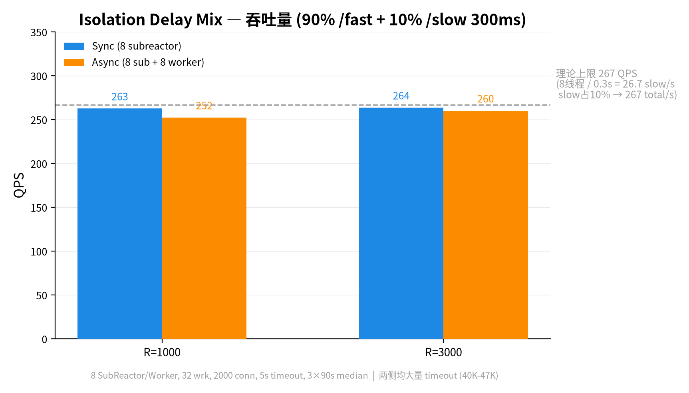
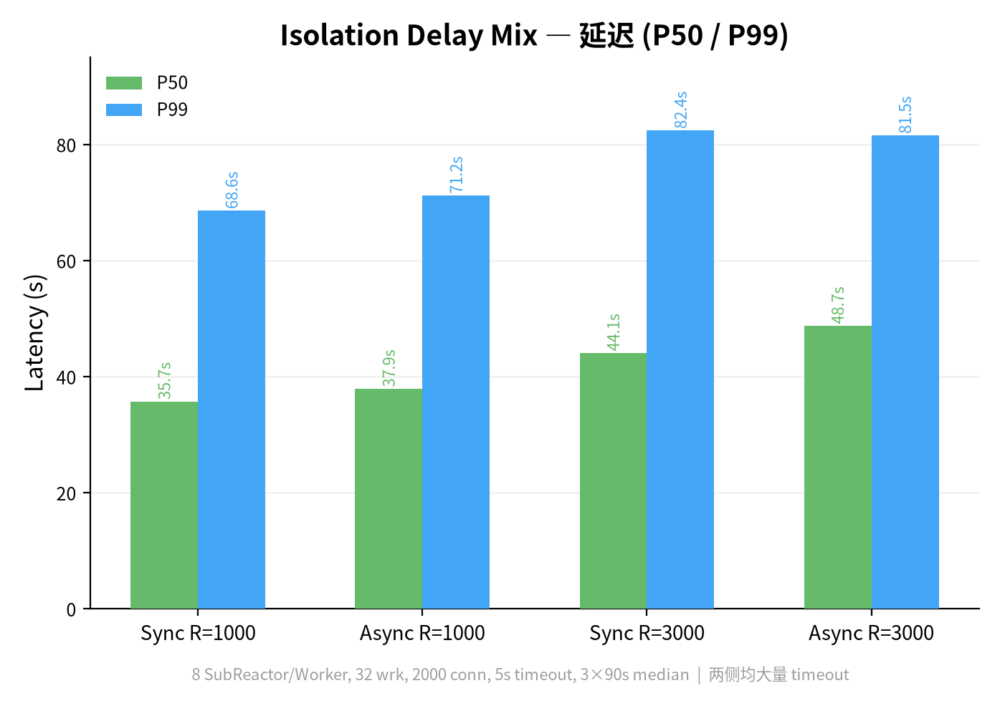

| 速率 | 模式 | QPS | vs 目标 | P50 | P99 | err_timeout |
|------|------|-----|---------|-----|-----|-------------|
| R=1000 | sync | 263 | 26.3% | 35.7s | 68.6s | 50K |
| R=1000 | async | 252 | 25.2% | 37.9s | 71.2s | 44K |
| R=3000 | sync | 264 | 8.8% | 44.1s | 82.4s | 42K |
| R=3000 | async | 260 | 8.7% | 48.7s | 81.5s | 42K |

sync 和 async 均严重退化，且表现几乎相同。原因很直接——线程数是硬上限。只有 8 个执行线程，每个 `/slow` 占用 300ms，每线程每秒最多处理 3.3 个 slow 请求，8 线程 × 3.3 = 26.7 slow/s，而 slow 占 10%，总吞吐上限 ≈ 267 QPS。实测 252–264 QPS，完全触及这个理论上限。大量请求 timeout（42K–50K）：`/fast` 请求排不上队，在队列中等待超过 5s 超时。

async 在这种场景下没有优势，因为 300ms 的 `sleep()` 是纯线程阻塞——sync 阻塞 SubReactor，async 阻塞 Worker，两者都绑死一个 OS 线程。异步模型的隔离优势在于"IO 线程不被阻塞"，但当业务本身长时间霸占执行线程时，无论 sync 还是 async 都受限于线程池大小。

### 6.3 隔离性结论

| 场景 | 瓶颈类型 | async 优势 | 原因 |
|------|---------|-----------|------|
| CPU 密集混合（compute_mix） | **框架隔离性** | **明显**（P99 降低 43–80%） | SubReactor IO 不被阻塞，仅 Worker 线程受 CPU 密集影响 |
| 长 IO 阻塞混合（delay_mix） | **线程数** | 无差异 | 两者都受限于执行线程数，300ms sleep 绑死线程 |

框架层 sync → async 的收益取决于阻塞任务的占比和时长。短时阻塞（~10ms CPU）场景下 async 隔离效果显著；长时阻塞（300ms IO）场景下瓶颈转移到了线程池容量，需要增加 Worker 线程数或采用非阻塞 IO 才能缓解。

---

## 七、性能瓶颈总结

| 瓶颈 | 本机 | 云端 #1 | 云端 #2 | 受影响负载 | 量化依据 |
|------|------|---------|---------|-----------|---------|
| 内存带宽 / 数据拷贝 | 严重 | 严重 | — | 16KB, 64KB | IPC 0.47, ~90% CPU 等待内存 |
| L1D Cache 容量 | 严重 | 中等 | — | 16KB | Cache Miss 49.2%, 每次 ~8 次 L3 miss |
| 内核网络 TX 路径 | 中等 | **严重 (38%)** | — | 全部 | 火焰图 `__ip_finish_output` + `__dev_queue_xmit` = 38% |
| sync delay 阻塞线程 | — | — | **严重** | IO 延迟 | P99 ≈ 604.7ms (delay-100ms) |
| async 线程池调度开销 | — | — | 中等 | CPU 计算 | 重计算 P99 从 5ms → 1.8s |
| epoll 上下文切换开销 | 轻微 | 中等 | — | sync-16+ | 每核 QPS 随线程数上升 |

关键量化：

- 64KB 负载 IPC 仅 0.37–0.47，约 90% CPU 时间在等待内存
- 16KB 下 Cache Miss 49.2%，每次请求约 8 次 L3 cache miss
- 云端 TX 路径占 38% CPU，每核吞吐 23K QPS (64KB) ≈ 1.5 GB/s/核
- sync delay-100ms 场景 P99 ≈ 604.7ms（线程阻塞，全部排队）
- 所有 baseline/scalability 测试零错误，客户端未饱和（除 sync-32 接近饱和）